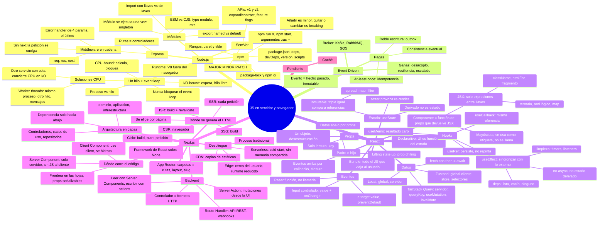

# Mapa mental: Node, React y Next

> En los nodos de un `mindmap` de Mermaid no pueden ir `( )`, `[ ]` ni `{ }`, porque son sintaxis de forma. Por eso aquí están escritos con palabras.

## El mismo mapa en texto

- **Node.js**: runtime de JS sobre V8
  - **Un hilo + event loop**: I/O-bound libera el hilo (`await`); CPU-bound lo bloquea → workers (mismo proceso, otro hilo) o servicio aparte con cola (convierte CPU en I/O)
  - **npm**: `package.json` (deps, devDeps, version, scripts), lock + `npm ci`, rangos `^`/`~`, `npm run X`
  - **SemVer**: añadir = minor; quitar/cambiar = major → APIs con v1/v2, expand/contract, feature flags
  - **Módulos**: named vs default, llaves en el import, ESM vs CJS, módulo = singleton
  - **Express**: rutas + middlewares `(req, res, next)`; `next()` o se cuelga; error handler de 4 params
- **Event Driven**: evento = hecho pasado → broker → consumidores; ganas desacoplo/resiliencia; pagas consistencia eventual, at-least-once (idempotencia), doble escritura (outbox)
- **React**: `UI = f(estado)`
  - Componente = función(props) → JSX; `<Comp/>`; solo expresiones en `{}`
  - Props: un objeto desestructurado, solo lectura, `key`
  - Estado: `useState` → re-render; inmutable porque `===` compara referencias; derivado se calcula
  - Eventos: pasar función; `e.target.value`; `preventDefault`; input controlado
  - Padre/hijo: datos abajo, eventos arriba (closure); lifting state up; prop drilling
  - Hooks: `useEffect` (externo, deps, limpieza), `useRef` (persiste sin repintar), `useMemo`, `useCallback`
  - Datos: fetch; TanStack Query (servidor); Zustand (global cliente); local/global/servidor
  - Bundle: el JS que viaja al usuario
- **Next.js**: React + rutas + servidor + despliegue, sobre Node
  - HTML: CSR / SSR / SSG / ISR, por página
  - Código: Server Components (sin JS al cliente) vs Client Components (`"use client"`, hidratan)
  - Ciclo: build → start → petición ejecuta la función del componente en Node
  - Backend: controlador = frontera HTTP; Route Handlers (API, webhooks); Server Actions (mutaciones UI)
  - Despliegue: proceso / serverless / edge / CDN; sin estado en memoria en serverless
  - Capas: controladores → casos de uso → repositorios; dependencia hacia abajo
- **Pendiente**: caché
